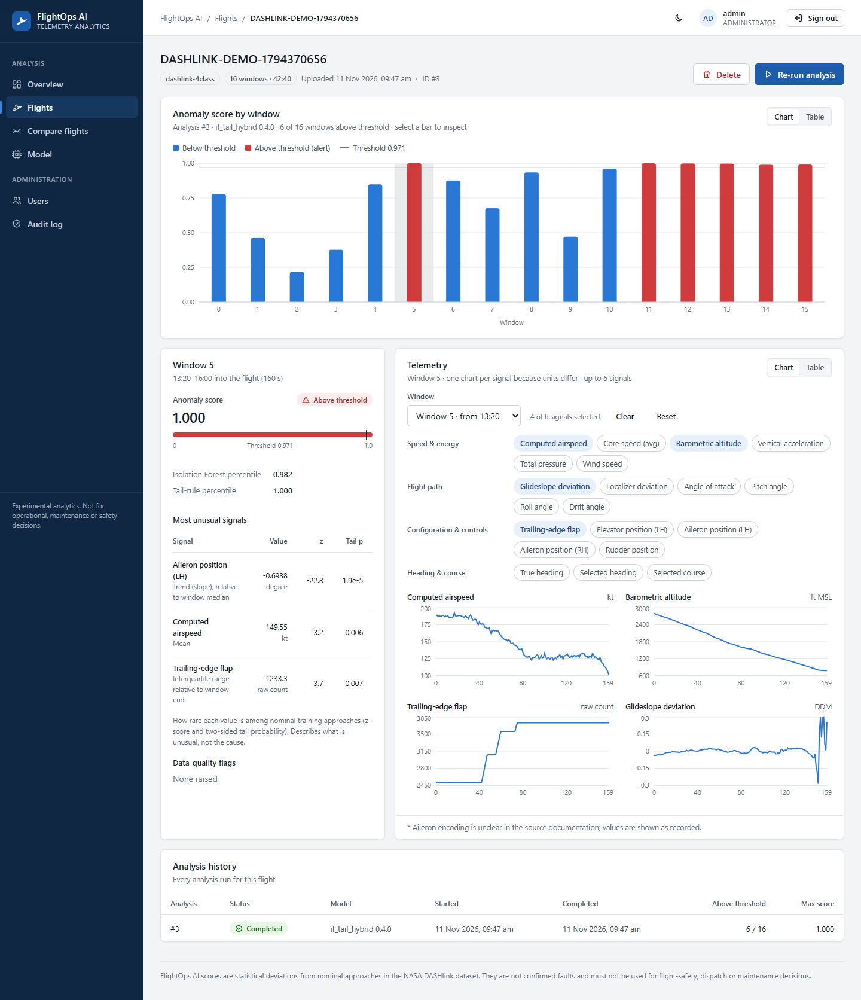

# FlightOps AI

Experimental flight-telemetry analytics: anomaly detection on aircraft final-approach data, a FastAPI
scoring service, a Spring Boot application backend (auth, flights, analyses, audit), and a React
analyst dashboard.



> **Not** an aircraft control, dispatch, maintenance or certified flight-safety system. Alerts are
> statistical deviations from nominal approaches and need engineering review.

The full project plan is in [documentation.md](documentation.md).

## Status

| Phase | Scope | Status |
|-------|-------|--------|
| 1 | Dataset acquisition, verification, data quality, EDA | Done |
| 2 | Feature engineering, splits, Isolation Forest baseline | Done |
| 3 | Autoencoder and model comparison (CPU and Kaggle GPU) | Done |
| 4 | FastAPI inference service | Done |
| 5 | Spring Boot application backend + PostgreSQL | Done |
| 6 | React + TypeScript analyst dashboard | Done |
| 7–8 | AI engineering assistant, MLOps | Not started |

```text
React dashboard :5173 ──/api──> Spring Boot backend :8080 ──> FastAPI inference API :8000 ──> if_tail_hybrid 0.4.0
                     │ users, flights, telemetry, analyses, anomaly events, audit
                     └──> PostgreSQL (Flyway-managed schema)
```

## Quick start (Windows)

Once setup is done (conda env `environ`, PostgreSQL, `.env` from `.env.example`, trained model; see
below):

```bat
start.bat              :: inference API (:8000) + backend (:8080), each in its own window
start.bat dashboard    :: ...and the dashboard (http://127.0.0.1:5173)
start.bat build        :: rebuild the backend jar first
stop.bat               :: stop only the FlightOps processes
```

`start.bat` checks prerequisites:

- `.env`, the conda env's Python, Java, the model artifact;
- that the ports are free (a second run refuses instead of starting duplicates);
- that the backend jar exists (built with Maven if missing).

It waits until each service reports healthy before starting the next. `stop.bat` matches FlightOps
processes by their exact command line, so other Java/Python/Node programs are never affected.

## Results

**Served model:** `if_tail_hybrid` **0.4.0**. It combines an Isolation Forest with a per-feature tail
rule, on input set **v3**: 170 window features from 17 channels, with absolute heading/course removed
and per-aircraft sensor offsets removed. Measured on the stratified test split, with the alert
threshold set so that 5% of nominal approaches are flagged:

| Model | PR-AUC | Precision | Recall | Flaps Late | Path High | Speed High | PR-AUC, aircraft held out |
|-------|-------:|----------:|-------:|-----------:|----------:|-----------:|--------------------------:|
| **if_tail_hybrid 0.4.0 (served)** | **0.410** | **0.468** | **0.391** | **97%** | 70% | 22% | **0.402 ± 0.036** |
| Isolation Forest 0.4.0 | 0.367 | 0.423 | 0.331 | 39% | 77% | 19% | 0.402 ± 0.028 |
| Conv autoencoder (input set v2) | 0.178 | 0.249 | 0.157 | 22% | 42% | 7% | 0.168 ± 0.017 |

Random detection scores about 0.10 PR-AUC (anomaly prevalence). Full methodology, every experiment
and the decision rules are in [docs/evaluation-report.md](docs/evaluation-report.md).

**Key data findings** (details in [docs/dataset-card.md](docs/dataset-card.md)):

- **Aircraft 657, 2001–2002:** the selected-course channel is faulty, and its Speed High labels look
  questionable. Results are reported both with and without this aircraft.
- **True heading near ±180° is corrupted**, so heading is not used as a model input.
- **Per-aircraft sensor offsets** in flap, elevator (aircraft 655 reads −40°), ailerons, rudder and
  vertical acceleration (aircraft 685 reads 0.90 g) are removed by making those signals relative.
- **97 duplicate windows** are dropped before splitting.

## Setup (Windows, conda env `environ`)

```powershell
conda activate environ                     # Python 3.12, PyTorch 2.13 CPU build
cd C:\Users\shash\FlightOps-AI
python -m pip install -r requirements.txt
python -m pip install -e ".[api]"          # this package + FastAPI/uvicorn
python -m ipykernel install --user --name flightops-ai --display-name "FlightOps AI (conda: environ)"
```

- `environ` sets `PYTHONNOUSERSITE=1` on activation, and so does the `flightops-ai` Jupyter kernel.
  This keeps a broken `ipykernel` in `%APPDATA%\Python` out of the env. Outside an activated env, run
  `$env:PYTHONNOUSERSITE = "1"` first.
- PyTorch is only needed for the autoencoder. CPU build:
  `python -m pip install torch --index-url https://download.pytorch.org/whl/cpu`.
- A plain venv also works (`py -3.12 -m venv .venv`, then the same commands). For WSL2/Linux, see
  documentation.md §8.

## Data

```powershell
python -m flightops.data.download     # NASA DASHlink URL, else verified Internet Archive copy; SHA-256 checked
python -m flightops.data.inspect --json-out artifacts/reports/dataset_inspection.json
python -m flightops.data.processed    # memory-mappable float32 working copy (~45 s, low RAM)
```

- **Dataset:** NASA DASHlink *Curated 4 Class Anomaly Detection Data Set*. 99,837 windows × 160 s ×
  20 variables, with labels Nominal / Speed High / Path High / Flaps Late Setting.
- **Never committed or re-hosted:** the licence is listed as "N/A", and the files total 1.7 GB.
- Provenance and checksums: [docs/dataset-card.md](docs/dataset-card.md). Variable definitions:
  [docs/data-dictionary.md](docs/data-dictionary.md).

## Train and evaluate

All models share one split (recorded as a `split_fingerprint`) and use nominal-only calibration.

```powershell
python -m flightops.models.train_hybrid        # served model, ~2 min: forest vs tail vs hybrid + aircraft folds
python -m flightops.models.train_baseline      # Isolation Forest alone, ~1 min
python -m flightops.models.train_autoencoder --smoke          # 1-min pipeline check
python -m flightops.models.train_autoencoder                  # full run, ~20 min CPU
python -m flightops.models.train_autoencoder --aircraft-cv    # + 5 aircraft folds (GPU recommended)
```

Outputs go to `artifacts/models/` and `artifacts/reports/`. Both are git-ignored. Earlier input sets
are archived in `artifacts/reports/v1/` and `v2/`.

### Training on a cloud GPU (Kaggle or Colab)

1. Push the branch (`git push`). The repo is public, so the notebook clones it.
   - Alternatively, set `CODE_SOURCE = "zip"` and upload `dist/flightops_src.zip`, built with
     `git archive --format=zip -o dist/flightops_src.zip HEAD`.
2. Import [notebooks/05_autoencoder_cloud_gpu.ipynb](notebooks/05_autoencoder_cloud_gpu.ipynb) and
   enable a GPU. On Kaggle, also turn **Internet on**.
3. Choose *Run All*. Step 3 prints the commit, input set and model versions: check they are current.
   The notebook downloads and verifies the dataset itself.
4. Download `flightops_results.zip` and extract it at the repo root
   (`Expand-Archive -Force flightops_results.zip .`). It contains only `artifacts/`.

## Inference API

```powershell
uvicorn app.main:app --app-dir services/inference-api --host 127.0.0.1 --port 8000
# interactive docs: http://127.0.0.1:8000/docs
python services/inference-api/examples/demo_client.py --per-class 2   # second terminal: real windows
```

| Method | Path | Purpose |
|--------|------|---------|
| GET | `/health` | Model loaded or not |
| GET | `/v1/model` | Model version, threshold, input variables and units, evaluation summary |
| POST | `/v1/score` | Score 1–64 windows → anomaly events (score, alert, top 3 unusual signals, quality flags) |

Full contract: [docs/api-contracts.md](docs/api-contracts.md). Service details:
[services/inference-api/README.md](services/inference-api/README.md).

## Application backend (Spring Boot)

Requires Java 21, Maven, PostgreSQL with a `flightops` database, and these values in the repo-root
`.env` (template: [.env.example](.env.example)): `DATABASE_URL`, `FLIGHTOPS_JWT_SECRET`,
`FLIGHTOPS_ADMIN_PASSWORD`.

```powershell
cd services\application-backend
mvn -B package                                   # 20 tests (uses a separate flightops_test DB)
java -jar target\application-backend-0.1.0.jar   # http://127.0.0.1:8080, needs the inference API running
# second terminal, repo root, conda activate environ:
python services/application-backend/examples/e2e_demo.py --per-class 2   # upload -> analysis -> anomalies
```

What it provides:
- **Login:** JWT login with roles (`ANALYST`, `ADMIN`).
- **Flights and telemetry:** upload, list and view; analysts only see their own flights.
- **Analyses:** asynchronous runs that call the inference API, with stored anomaly events.
- **User management and an audit trail.**

Details: [services/application-backend/README.md](services/application-backend/README.md).

## Analyst dashboard (React)

```powershell
cd frontend\dashboard
npm ci
npm run dev            # http://127.0.0.1:5173, needs the backend (:8080) and inference API (:8000) running
```

Pages:
- **Overview:** KPIs, alerts by flight, recent analyses.
- **Flights:** list and upload.
- **Flight detail:** anomaly timeline, per-window evidence, telemetry small multiples, run history.
- **Compare flights.**
- **Model card.**
- **Admin:** users and audit log.

The design is corporate, with light and dark themes. Chart colours are validated for colour-vision
deficiency and every text colour meets WCAG AA contrast. Details:
[frontend/dashboard/README.md](frontend/dashboard/README.md).

## Notebooks

| Notebook | Content |
|----------|---------|
| [01_dataset_overview](notebooks/01_dataset_overview.ipynb) | Class balance, aircraft, airports, per-class behaviour |
| [02_data_quality](notebooks/02_data_quality.ipynb) | Integrity, duplicates, variable issues, quality flags |
| [03_exploratory_analysis](notebooks/03_exploratory_analysis.ipynb) | Variability, correlation, class separation, aircraft 657 (input set v1) |
| [04_baseline_anomaly_detection](notebooks/04_baseline_anomaly_detection.ipynb) | First Isolation Forest results (input set v1) |
| [05_autoencoder_cloud_gpu](notebooks/05_autoencoder_cloud_gpu.ipynb) | Kaggle/Colab/local training and model comparison |

Notebooks 03–04 record the v1 analysis as it was run. Current results are in the evaluation report.

## Tests

```powershell
pytest                                           # Python: 84 tests, synthetic data only (no dataset needed), ~20 s
cd services\application-backend; mvn -B test     # Java backend: 23 tests (unit + full-stack on PostgreSQL)
cd frontend\dashboard; npm run typecheck; npm test   # dashboard: strict TypeScript + 17 tests
```

`test_no_secrets.py` fails if a committed file contains an API key, token or database password.
Real values belong only in the git-ignored `.env`.

## Project layout

```text
configs/                 data.yaml (verified dataset schema), model.yaml (splits, threshold, models)
data/raw/, processed/    dataset files and derived caches (git-ignored)
docs/                    dataset card, data dictionary, evaluation report, API contracts
notebooks/               EDA, data quality, baseline, cloud GPU training
services/inference-api/  FastAPI service, demo client
services/application-backend/  Spring Boot backend (Java 21): auth, flights, analyses, audit; Flyway SQL; e2e demo
frontend/dashboard/      React + TypeScript dashboard (Vite): pages, charts, design system, tests, visual QA script
src/flightops/
  data/                  download, inspect, processed copy, quality flags, schema, splits
  features/              preprocessing (input set v3) and window features, with fingerprinted caches
  models/                isolation_forest, hybrid (served), autoencoder, training CLIs
  evaluation/            metrics (alert-budget thresholds, PR-AUC, per-class rates)
  inference/             model loading and scoring used by the API
  pipeline.py            shared data/split/evaluation so models are compared on identical splits
tests/unit/, integration/  unit tests and API tests
artifacts/               trained models and reports (git-ignored)
```

## Documentation

- [documentation.md](documentation.md): project plan, phases and checklists
- [docs/dataset-card.md](docs/dataset-card.md): source, checksums, data-quality findings
- [docs/data-dictionary.md](docs/data-dictionary.md): variables, units, observed ranges
- [docs/evaluation-report.md](docs/evaluation-report.md): all experiments, results and model decisions
- [docs/api-contracts.md](docs/api-contracts.md): inference API and application backend contracts
- [docs/design-audit.md](docs/design-audit.md): dashboard design audit (consistency, UI/UX, responsive, accessibility)
