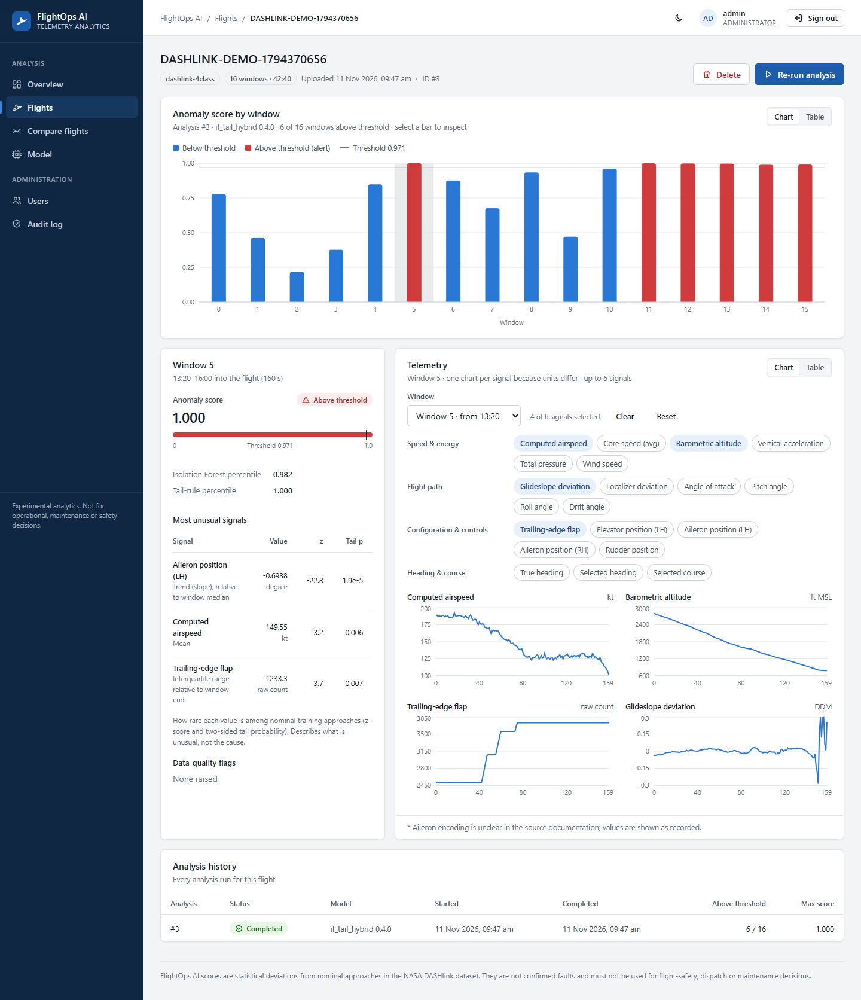

# FlightOps AI: Analyst Dashboard (Phase 6)

React + TypeScript dashboard for the application backend (`services/application-backend`).



**Stack:** React 19, React Router 7, TanStack Query 5, Recharts 3, Vite 8, TypeScript 6, Vitest 5.
All versions are pinned exactly in `package.json`, and each release was at least two weeks old when
added.

## Run locally

Requirements:

- Node 24+.
- The backend running on `:8080`, which itself needs the inference API on `:8000` (see the root README).

```powershell
cd C:\Users\shash\FlightOps-AI\frontend\dashboard
npm ci                 # once
npm run dev            # http://127.0.0.1:5173 (hot reload), /api proxied to the backend
# or the production build:
npm run build; npm run preview    # http://127.0.0.1:4173
```

Sign in with a backend account. The first admin is `FLIGHTOPS_ADMIN_USERNAME` /
`FLIGHTOPS_ADMIN_PASSWORD` from the repo-root `.env`. Set `FLIGHTOPS_BACKEND_URL` to proxy to a
backend that is not on `127.0.0.1:8080`.

## Pages

| Page | Content |
|------|---------|
| **Overview** | KPI tiles (flights, windows analysed, above threshold, analyses); windows above threshold by flight; recent analyses; model in service |
| **Flights** | Paged list; upload a flight as JSON, validated in the browser before sending |
| **Flight detail** | Anomaly score per window with the threshold; selected-window evidence (score components, most unusual signals with z-score and tail probability, data-quality flags); telemetry small multiples for any 6 of the 20 signals; run, re-run or delete; analysis history with live status |
| **Compare flights** | One signal from two windows on a common axis, with both anomaly scores |
| **Model** | Model card: version, threshold policy, test and unseen-aircraft metrics, input signals and units |
| **Users / Audit log** | Admin only: create, enable or disable accounts; audit trail |

## Design

- **Corporate visual language:**
  - deep-navy navigation;
  - neutral surfaces with hairline borders;
  - the system UI font;
  - an 8 px spacing grid;
  - restrained accents.

  Light and dark themes are both designed (toggle in the top bar, remembered per browser).
- **Charts:**
  - **Palette and accessibility:** the validated data-viz palette (blue / orange / status red) passes
    lightness, chroma, colour-vision-deficiency separation and contrast checks in both themes. Every
    chart has a **Table** view, and status always pairs an icon with a label, never colour alone.
  - **Marks:** 2 px lines, bars at most 24 px wide with 4 px rounded tops, solid hairline grids, and
    hover tooltips.
  - **Axes:** signals with different units are **small multiples, never dual-axis**.
- **Text contrast:** every text/background pair meets **WCAG AA (≥ 4.5:1)**. The values were computed,
  not eyeballed: links 6.6:1 light / 8.3:1 dark, muted text ≥ 4.8:1.

Design audit and changes: [docs/design-audit.md](../../docs/design-audit.md).

## Security

- **Session:** the token is kept in `sessionStorage` (cleared when the tab closes) and in memory, and is
  never put in URLs or logs. Any `401` signs the user out, and sessions end at token expiry.
- **Same-origin API:** all calls go through the `/api` proxy, so no CORS is needed.
- **Content-Security-Policy:** the production build includes a strict CSP `<meta>`
  (`default-src 'self'`, no inline scripts, `connect-src 'self'`). `frame-ancestors` cannot be set
  in `<meta>`. The web server serving `dist/` must send
  `Content-Security-Policy: frame-ancestors 'none'` as a header (Phase 8).
- **No untrusted HTML:** no `dangerouslySetInnerHTML`, and server data is rendered as text only.

## Quality checks

```powershell
npm run typecheck      # strict TypeScript (incl. noUncheckedIndexedAccess), tests included
npm test               # 17 tests
npm run screenshots    # visual QA in the installed Microsoft Edge; fails on console errors or failed requests
node scripts/audit-capture.mjs   # responsive (1024 / 390 px), empty states, focus, validation; fails on mobile overflow
```

The tests cover:

- that the telemetry contract matches the Python schema;
- upload validation and the API client's error handling;
- the full sign-in flow, including role-based navigation and sign-out on 401;
- that badges always carry an icon and a label;
- the chart/table toggle.

`npm run screenshots` needs the three services and the preview server running. It takes
`FLIGHTOPS_UI_USER` / `FLIGHTOPS_UI_PASSWORD` and writes PNGs to `screenshots/` (git-ignored).
